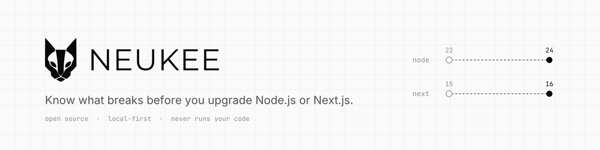
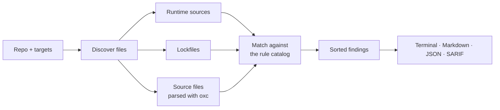
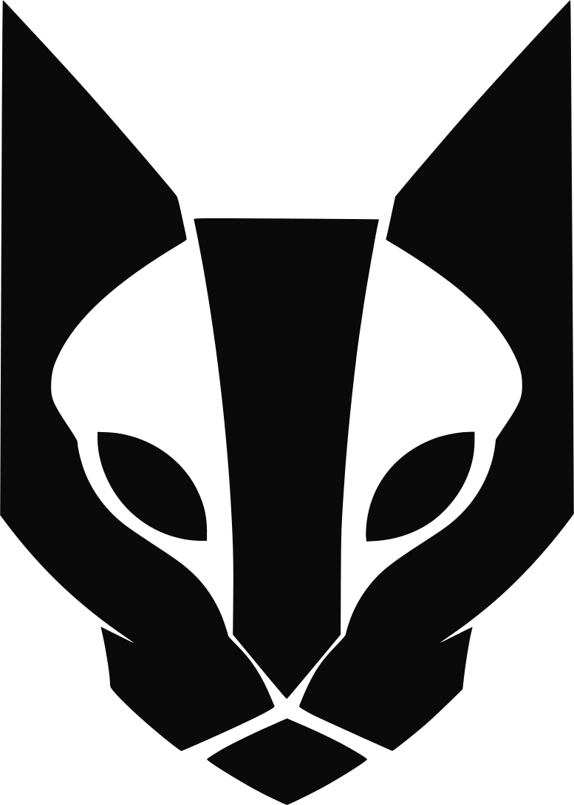

<p align="center">
  <picture>
    <source media="(prefers-color-scheme: dark)" srcset=".github/assets/banner-dark.svg">
    
  </picture>
</p>

<p align="center">
  <a href="https://github.com/neukee/neukee/actions/workflows/ci.yml"></a>
  <a href="https://scorecard.dev/viewer/?uri=github.com/neukee/neukee"></a>
  <a href="LICENSE"></a>
  <a href="docs/TASKS.md"></a>
  <a href="https://pkg.pr.new/~/neukee/neukee"></a>
</p>

Neukee is a local-first scanner for Node.js and Next.js upgrades. Point it at a repository and a target version, and it reports what will break before you change a line. It reads your code, lockfile and deployment config on your machine. It never runs your code, never uses the network and never sends anything anywhere.

> [!IMPORTANT]
> **Pre-release.** The scanner is under active development. Version 0.1.0 is planned for December 8, 2026, and nothing is on npm yet. This README separates what exists today from what is planned, and the work is tracked in the open in [`docs/TASKS.md`](docs/TASKS.md).

## Why

Upgrades rarely fail on the change you read about. They fail on the one you didn't connect to your repo:

- `.nvmrc` says 24, but the Dockerfile still builds on 20, so production runs the old runtime after a "successful" upgrade.
- A dependency compiles native code at install time and breaks on the new Node.js ABI.
- A Next.js API became async, and every synchronous call site is now a bug.

Release notes list what changed. Neukee's job is to find which of those changes touch your code, and point at the exact lines.

## What v0.1.0 will check

| Area          | What gets flagged                                                                                                                                                                                                                                                                                               |
| ------------- | --------------------------------------------------------------------------------------------------------------------------------------------------------------------------------------------------------------------------------------------------------------------------------------------------------------- |
| Runtime drift | Declared Node.js versions below your target, sources that disagree with each other, and versions past end-of-life. Reads `.nvmrc`, `.node-version`, `engines`, `volta`, Dockerfiles and GitHub Actions workflows.                                                                                               |
| Native addons | Dependencies that build native code at install time, read from the install-script flags in `package-lock.json` and `pnpm-lock.yaml`.                                                                                                                                                                            |
| Next.js 16    | `cookies()`, `headers()` and `draftMode()` called without `await`; `params` and `searchParams` read synchronously; `middleware` that must become `proxy`; custom `webpack` config; removed config keys; `next lint` in scripts; parallel route slots without `default`; segment config under `cacheComponents`. |

Every finding carries a severity, a precise location (file, line and column), a suggested fix and a link to the official release note or migration guide it comes from.

Planned command (from the CLI's current help text):

```text
neukee scan [path] [--target tool@version]... [--format terminal|markdown|json|sarif]
```

Output formats: terminal, Markdown for pull request comments, JSON validated against a versioned schema, and SARIF for GitHub code scanning. At launch, the docs include a copy-paste GitHub Actions workflow that runs the CLI and uploads SARIF.

## Guarantees

These are design rules, not aspirations. Each one is enforced by a test or by review.

| Rule                            | What it means                                                                                                                                             |
| ------------------------------- | --------------------------------------------------------------------------------------------------------------------------------------------------------- |
| No network                      | No `fetch`, sockets or DNS. Every test runs with all three blocked ([`vitest.setup.ts`](vitest.setup.ts)), so an accidental network call fails the build. |
| Read-only                       | Never runs the scanned project's code, scripts or package manager. Writes only the output file you name.                                                  |
| Nothing leaks                   | Reports contain repo-relative paths only, never absolute paths, and never file contents beyond the one line needed to locate a finding.                   |
| Deterministic                   | Findings are sorted by a total order, so the same repo always produces byte-identical output. Safe to snapshot and diff in CI.                            |
| Sourced rules                   | Every rule links the official release note it is based on and ships with a positive and a negative fixture.                                               |
| One bad file never stops a scan | A file that can't be parsed becomes a diagnostic in the report. Detectors never throw.                                                                    |

The full threat model is in [`docs/ARCHITECTURE.md`](docs/ARCHITECTURE.md#7-security-model).

## How it works



Detection logic lives in code. Knowledge (what breaks, how severe it is, how to fix it and where the source is) lives in [`catalog/`](catalog), one reviewed YAML file per rule.

| Package           | Role                                             | Today                                              |
| ----------------- | ------------------------------------------------ | -------------------------------------------------- |
| `@neukee/core`    | Report types, JSON Schema, validator, sort order | Built                                              |
| `@neukee/scanner` | File discovery, detectors, rule matching         | In progress                                        |
| `@neukee/cli`     | The `neukee` command                             | `--help` and `--version` only; scan is in progress |

Dependencies flow one way: cli → scanner → core.

## Engineering standards

- Strict TypeScript, ESM only, Node.js 22 or later.
- Every pull request runs CI on Ubuntu and Windows with Node.js 22 and 24. `main` accepts changes only through pull requests with passing checks.
- Unused code is caught by Knip, and package correctness by publint and Are the Types Wrong.
- Nightly mutation testing with Stryker.
- All GitHub Actions are pinned to commit SHAs, tokens are least-privilege, and Dependabot proposes updates.
- OpenSSF Scorecard, CodeQL and secret scanning with push protection run on the repository.
- Neukee is built with AI assistance (Claude Code). Every pull request is reviewed by CodeRabbit and approved by the maintainer, and the same gates apply to every line.

## Roadmap

| When                     | What                                                                                                                                                                                |
| ------------------------ | ----------------------------------------------------------------------------------------------------------------------------------------------------------------------------------- |
| v0.1.0, December 8, 2026 | CLI scanner: runtime drift, native addons, Next.js 16 rules, npm and pnpm lockfiles, all four output formats                                                                        |
| Two weeks after launch   | Yarn lockfiles (v1, then Berry), Node.js 24 and 26 code rules, deployment config (Vercel, Netlify, Serverless, AWS SAM), a packaged GitHub Action, fleet mode for many repositories |
| Later                    | A behavioral verification engine, shipped as a separate package under its own license ([ADR-005](docs/DECISIONS.md))                                                                |

## Development

```bash
corepack enable
pnpm install
pnpm verify       # typecheck, lint and tests
pnpm check:all    # verify, plus unused-code and package checks
pnpm build
node packages/cli/dist/index.js --help
```

New here? Read [`CONTRIBUTING.md`](CONTRIBUTING.md), then [`docs/ARCHITECTURE.md`](docs/ARCHITECTURE.md).

## Community and support

- Found a false positive or a missing breaking change? [Open an issue](https://github.com/neukee/neukee/issues/new/choose).
- Found a security issue? Report it privately; see [`SECURITY.md`](SECURITY.md).
- Updates: [LinkedIn](https://www.linkedin.com/company/neukee) · [X](https://x.com/neukee4dev)

## License

The scanner, core and CLI are licensed under [Apache-2.0](LICENSE). See [`NOTICE`](NOTICE).

<br>
<p align="center">
  <picture>
    <source media="(prefers-color-scheme: dark)" srcset=".github/assets/mark-dark.svg">
    
  </picture>
</p>
