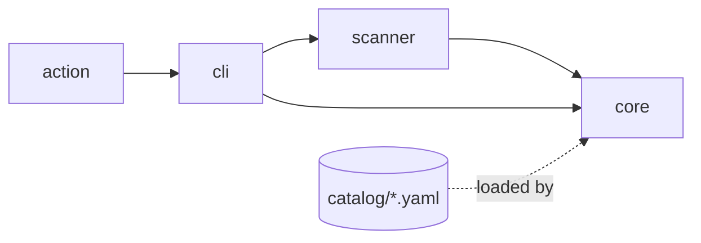
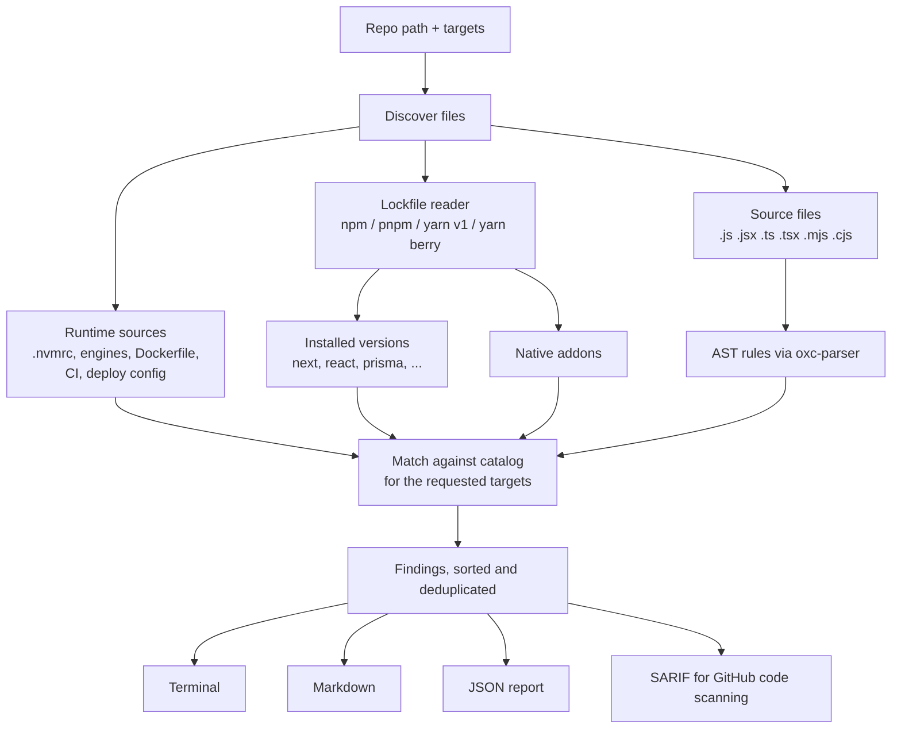
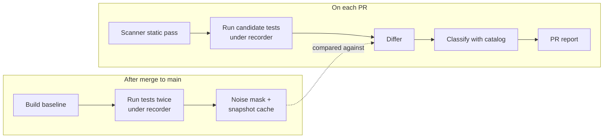

# Architecture

> Name: **Neukee**, a product of GOkit4dev (ADR-008). The trademark search runs in T-053, before the first npm publish.

This document is the source of truth for how the system is built. If code and this document disagree, the code is wrong or this document must be updated in the same change, with an entry in `docs/DECISIONS.md`.

## 1. What the system is

A verification tool for dependency, runtime and framework upgrades in Node.js and Next.js applications. It is delivered in two products that share one core:

| Product     | Release                          | What it does                                                                                                                                         | Runs where                                                       |
| ----------- | -------------------------------- | ---------------------------------------------------------------------------------------------------------------------------------------------------- | ---------------------------------------------------------------- |
| **Scanner** | v0a (launch target: Dec 8, 2026) | Static analysis: reads lockfiles, runtime config, deployment config and source code; reports what blocks a target upgrade (e.g. Node 24, Next.js 16) | A developer's machine (CLI) or the customer's CI (GitHub Action) |
| **Engine**  | v0b (after the scanner launch)   | Runs the old and new versions side by side on the customer's tests and reports behavioral differences                                                | The customer's CI only                                           |

Both are **local-first**: no server, no database, no account, no network calls. This is a deliberate product decision (privacy, security review, EU buyers) and an engineering one (nothing to host, nothing to break at 3am).

## 2. Stack

| Concern       | Choice                                                                          | Why                                                                                                         |
| ------------- | ------------------------------------------------------------------------------- | ----------------------------------------------------------------------------------------------------------- |
| Language      | TypeScript, `strict` on, ESM only                                               | Same ecosystem as the users; types are the contract between packages                                        |
| Runtime       | Node.js ≥ 22 for users; Node 24 LTS for development                             | Node 20 is end-of-life; 22 and 24 are supported LTS lines                                                   |
| Packages      | pnpm workspaces (monorepo)                                                      | One repo, several publishable packages, strict dependency isolation                                         |
| Build         | `tsc` for libraries; `esbuild` to bundle the GitHub Action                      | Fewest moving parts; Actions need a single bundled file                                                     |
| Tests         | Vitest                                                                          | Fast, ESM-native, snapshot support                                                                          |
| Lint + format | Biome                                                                           | One fast tool instead of ESLint + Prettier                                                                  |
| JS/TS parsing | `oxc-parser`                                                                    | Fast, error-tolerant, does not depend on the TypeScript compiler API (which TypeScript 7 does not ship yet) |
| YAML          | `yaml`                                                                          | pnpm lockfiles, Yarn Berry lockfiles, GitHub workflow files, catalog entries                                |
| Versions      | `semver`                                                                        | Range and version comparison                                                                                |
| CLI arguments | `node:util` `parseArgs`                                                         | Built in; one fewer dependency to trust                                                                     |
| Release       | Changesets + npm trusted publishing (OIDC) from GitHub Actions, with provenance | Signed, traceable releases with no stored npm token; buyers' security teams check this                      |
| CI            | GitHub Actions (pinned to commit SHAs)                                          | Where the users are                                                                                         |

**Dependency rule:** every new runtime dependency needs an entry in `docs/DECISIONS.md` (why it is needed, its maintenance status, its install scripts). A security tool with 300 transitive dependencies will not pass a buyer's review.

**Not in this stack (on purpose):** Vercel, a database, a backend, user accounts, telemetry. The marketing site and docs live in a separate repository and may use Vercel; the product never calls home.

## 3. Repository layout

```
neukee/
├── CLAUDE.md                 # Project memory for Claude Code (read every session)
├── docs/                     # Architecture, specs, tasks, progress, decisions
├── catalog/                  # Versioned knowledge: what breaks in each release
│   └── <id>.yaml             #   one YAML file per entry, path = id (e.g. next16/sync-request-apis.yaml)
├── packages/
│   ├── core/                 # Types, report schema, catalog loader. Depends on nothing internal.
│   ├── scanner/              # Detectors and the scan pipeline. Depends on core.
│   ├── cli/                  # `neukee` command. Depends on scanner + core.
│   └── action/               # GitHub Action wrapper (task T-040). Depends on cli.
├── fixtures/                 # Small sample repos used by tests (never real customer code)
└── .claude/                  # Claude Code skills, reviewer agent, settings, hooks
```

### Dependency direction (enforced by `test/dependency-direction.test.ts`)



A package may only import from packages to its right. `core` imports nothing internal. Nothing imports from `cli` or `action`.

## 4. The scanner pipeline



### Stages and their contracts

1. **Discover** — walk the repo from the given path. Respect `.gitignore`, always skip `node_modules`, `.git`, build output (`.next`, `dist`, `build`, `coverage`). Skip files over 1 MB and record them as skipped. Follow no symlinks at all, inside or outside the repo: each is skipped with a diagnostic (ADR-015).
2. **Detect** — each detector is a pure function: `(context) => Finding[]`. A detector never throws; failures become `Diagnostic` entries in the report (e.g. "could not parse pnpm-lock.yaml at line 40"). One broken file never stops a scan.
3. **Match** — detectors produce raw facts; catalog entries turn facts into findings for the requested targets. Detection logic lives in code; knowledge (what breaks, severity, fix, source link) lives in the catalog.
4. **Report** — findings are sorted by a total order (`compareFindings`): severity, then the first location's file, line and column (absent sorts first), then rule id, target tool, target version and message. Any tie left after those is broken by the remaining fields: title, fix (absent first), sourceUrl, then every location in turn. So two findings compare equal only if they are equal in every field. Text compares by code unit, never by locale. The same input in any order always produces byte-identical output. This is what makes snapshot tests and CI comparisons possible.

## 5. Core types (packages/core)

These are the contract. Every change to them, or to the report schema, needs a decision record and a deliberate snapshot update. Whether it also bumps `schemaVersion` follows the compatibility policy below.

```ts
type Severity = "action-required" | "warning" | "info";

interface Target {
  tool: "node" | "next" | "react" | "prisma";
  version: string;
} // e.g. { tool: "node", version: "24" }

interface Location {
  file: string;
  line?: number;
  column?: number;
} // file is repo-relative, forward slashes

interface Finding {
  ruleId: string; // e.g. "next16/sync-request-apis" — matches a catalog entry id
  severity: Severity;
  title: string; // one line, plain language
  message: string; // what was found, where, why it matters for this target
  fix?: string; // the documented fix
  sourceUrl: string; // the official release note or migration guide
  locations: Location[];
  target: Target;
}

interface Diagnostic {
  level: "error" | "warning";
  message: string;
  file?: string;
}

interface ScanReport {
  schemaVersion: 1;
  tool: { name: string; version: string };
  scannedAt: string; // ISO timestamp — the ONLY non-deterministic field; excluded from snapshots
  root: "."; // always "." — never an absolute path (no leaking machine paths)
  targets: Target[];
  detected: { node: string[]; packageManager?: string; frameworks: Record<string, string> };
  findings: Finding[];
  diagnostics: Diagnostic[];
  stats: { filesScanned: number; filesSkipped: number }; // counts only: no timing, it differs on every run
}
```

### Compatibility policy (`schemaVersion`)

- **Within `schemaVersion: 1`**, we may add **optional** fields. Consumers must ignore fields they don't know.
- **Removing, renaming or retyping a field, or changing its meaning**, bumps `schemaVersion`. So does making an optional field required.
- **Our own validator stays strict.** The published schema keeps every object closed, so `validateReport` rejects fields it doesn't know. Any added field goes into the schema, the types and the tests in the same PR that adds it. A consumer that validates reports with our schema should use the schema from the same `@neukee/core` version that produced them.
- **Every schema change needs an ADR**, breaking or not. The constraint snapshot in the tests fails until the change is made on purpose.

### The report schema (`packages/core/schema/scan-report.v1.json`)

The JSON Schema is hand-written (draft 2020-12) and published with `@neukee/core`. `validateReport(value)` checks a parsed report against it and returns either the typed report or every problem as `{ path, message }`. ADR-004 allows no JSON Schema library at runtime, so `validateReport` interprets only the keywords the schema uses. Tests pin the schema to that subset, generate a violation for every constraint, and keep the schema's fields in agreement with the TypeScript types. The schema says more than the types can (ADR-011):

- Every object is closed (`additionalProperties: false`): a misspelled or extra field is an error for our validator. This is the producer's check on its own output; consumers still ignore unknown fields (compatibility policy above).
- Only `scannedAt` varies between runs of the same scan. `stats` holds counts only.
- `Location.file` and `Diagnostic.file` are canonical repo-relative paths. They use forward slashes and never contain a leading `/`, a drive letter or other `scheme:` prefix, a backslash, a `.` or `..` segment, an empty segment, a trailing `/`, a control character (C0, DEL, C1) or a bidirectional-override character (U+202A–202E, U+2066–2069) that could disguise a name in terminal or PR output.
- `line` and `column` are integers starting at 1. Columns count UTF-16 code units, matching JavaScript string indexes and editors. SARIF output (T-032) states `columnKind: "utf16CodeUnits"` explicitly instead of relying on a default.
- `sourceUrl` is an `https://` URL with a dotted host name, then an optional port (1–65535, no leading zero) and path, query or fragment. `title` is a single line. Required strings are non-empty.
- `ruleId` is a catalog id: lowercase segments of `a–z`, `0–9`, `.` and `-`, joined by `/`, at least two segments (`next16/sync-request-apis`). The catalog loader (T-003) uses the same grammar.
- `scannedAt` is ISO 8601 with a time zone (`Z` or `±hh:mm`, offsets up to ±14:00). The pattern checks that months, days, hours, minutes and seconds are in range. `format: "date-time"`, which `validateReport` asserts, also checks that the date exists: no Feb 30, and no Feb 29 outside leap years. Generic JSON Schema validators treat `format` as an annotation unless format assertion is turned on.
- Every pattern is written so matching stays linear on long, hostile input (no nested ambiguous quantifiers).
- `locations` may be empty for repo-wide findings.

## 6. The catalog

The catalog is the product's knowledge and its long-term moat. Each entry is one YAML file at `catalog/<id>.yaml`, where the path is the id (ADR-014). The real first entry, `catalog/next16/sync-request-apis.yaml`:

```yaml
id: next16/sync-request-apis
title: Synchronous request APIs are removed
applies:
  tool: next
  introducedIn: "16.0.0" # the version where this starts to apply
severity: action-required
detector: ast/sync-request-api # which code-level detector produces the facts
message: >-
  cookies(), headers() and draftMode(), params (in layouts, pages, route handlers, default.js and
  metadata image routes) and searchParams (in pages) can only be accessed asynchronously.
  Next.js 15 kept temporary synchronous compatibility; Next.js 16 removes it.
fix: >-
  Run `npx @next/codemod@canary next-async-request-api .`, then resolve the codemod's error
  comments and `UnsafeUnwrapped` casts. In synchronous Client Components, use React's `use` where
  appropriate.
sourceUrl: https://nextjs.org/docs/app/guides/upgrading/version-16#async-request-apis-breaking-change
fixtures:
  positive: fixtures/rules/next16-sync-request-apis/positive
  negative: fixtures/rules/next16-sync-request-apis/negative
```

**Catalog rules (enforced by `loadCatalog` and its tests, ADR-003, ADR-014):**

- Every entry has a `sourceUrl` on an official host: `nextjs.org`, `nodejs.org`, `react.dev` or `www.prisma.io`. It must be a canonical https URL (unchanged by `new URL()`) with no credentials or port, and the hostname must equal an official host exactly. Adding a host needs an ADR line. No entry is written from memory.
- Every entry has a positive fixture (must produce the finding) and a negative fixture (must not), both folders under the top-level `fixtures/`. The loader checks the paths; the tests check the folders exist, because the npm package ships the catalog without fixtures.
- The file path is the id, with the lowercase `.yaml` extension. Fields are closed (no unknown keys). `applies.introducedIn` is `x.y.z`. `title` is one line.
- Every `catalog/**/*.yaml` is an entry, so data that isn't an entry (such as Node release dates for T-014) lives somewhere else.
- The loader treats YAML as untrusted even though the catalog is ours: core schema only, any parser warning is fatal (no custom tags), aliases are capped, there's a 64 KiB size limit, and it follows no symlinks. One bad file is an error naming it; the rest still load.
- Severity is `action-required` only when the change breaks the build or the running app; `warning` for deprecations; `info` for behavior changes worth knowing.

## 7. Security model

The scanner reads code that belongs to someone else. Its guarantees:

1. **No network.** No `fetch`, no sockets, no DNS. Enforced by a test setup that makes any network call fail (`vitest.setup.ts`).
2. **Read-only.** It writes only the output file the user names. It never runs the scanned project's code, scripts or package manager.
3. **No absolute paths or secrets in output.** Paths are repo-relative. File contents are never copied into reports beyond the single line needed to locate a finding.
4. **Minimal Action permissions.** `contents: read`; `security-events: write` only when the user enables SARIF upload.
5. **Supply chain.** Few dependencies, pinned Actions, npm provenance, a lockfile committed, Renovate/Dependabot on our own repo.
6. **Trust boundary.** Catalog files are trusted package content. Every file in a scanned repository is hostile. Readers of scanned files get the full defenses (T-005: one file handle per read, a size cap, regular files only, no-follow or realpath containment). The catalog loader keeps only cheap guards (safe YAML, a size cap, no symlinks); races that need write access to the package folder are out of scope, because that access already allows editing the entries (ADR-014).

## 8. Quality gate (every change, no exceptions)

`pnpm verify` runs, in order: typecheck → lint → tests (unit, rule fixtures, snapshot tests on fixture repos). CI runs the same command on Node 22 and 24, on Linux and Windows.

Around it (ADR-007), because AI writes both the code and the tests:

- `pnpm check:all` adds **Knip** (unused files, exports, dependencies) and `pack:check` (**publint** and **Are the Types Wrong**). CI runs both in the `quality` job.
- **Stryker** mutation testing runs nightly; the score must reach 80% on core and scanner (T-038).
- **CodeRabbit** reviews every PR with the rules in `.coderabbit.yaml`; **CodeQL** and **OpenSSF Scorecard** run on GitHub; **Dependabot** keeps SHA-pinned Actions and dev tools current.
- From T-037, a nightly **corpus job** scans 100+ pinned public repos and fails on any crash or unexpected output change.

**How we avoid breaking old work (regression strategy):**

- **Golden snapshots:** each fixture repo `fixtures/repos/<name>` has a committed expected report, `fixtures/expected/<name>.json`, kept outside the repo so file discovery never scans it. `scanFixture` fixes `scannedAt` and the tool version, so a golden report changes only when scanner output changes. Any change in output fails the test until a human-readable reason is written in the commit message and the snapshot is deliberately updated.
- **Rule fixtures:** every catalog entry keeps its positive/negative fixtures forever.
- **Contract tests:** core types and the JSON schema are tested; breaking them requires a schema version bump.
- **Small steps:** one task per change; the gate must pass before the next task starts.

## 9. The engine (v0b), at architecture level

Designed now so the scanner does not paint us into a corner; built after the scanner launches. Full outline in `docs/SPEC-ENGINE.md`.



Future packages: `recorder` (Node `diagnostics_channel` subscribers loaded with `--import`), `runner` (baseline/candidate orchestration and caching), `differ` (normalization, noise mask, classification). They depend on `core`; `scanner` stays independent of them.
