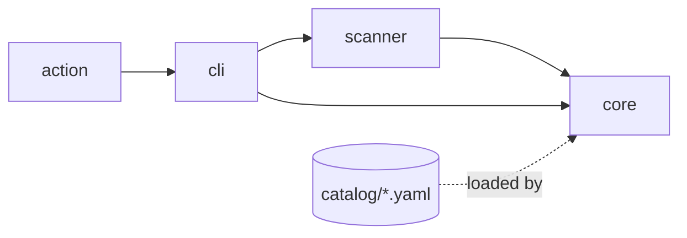
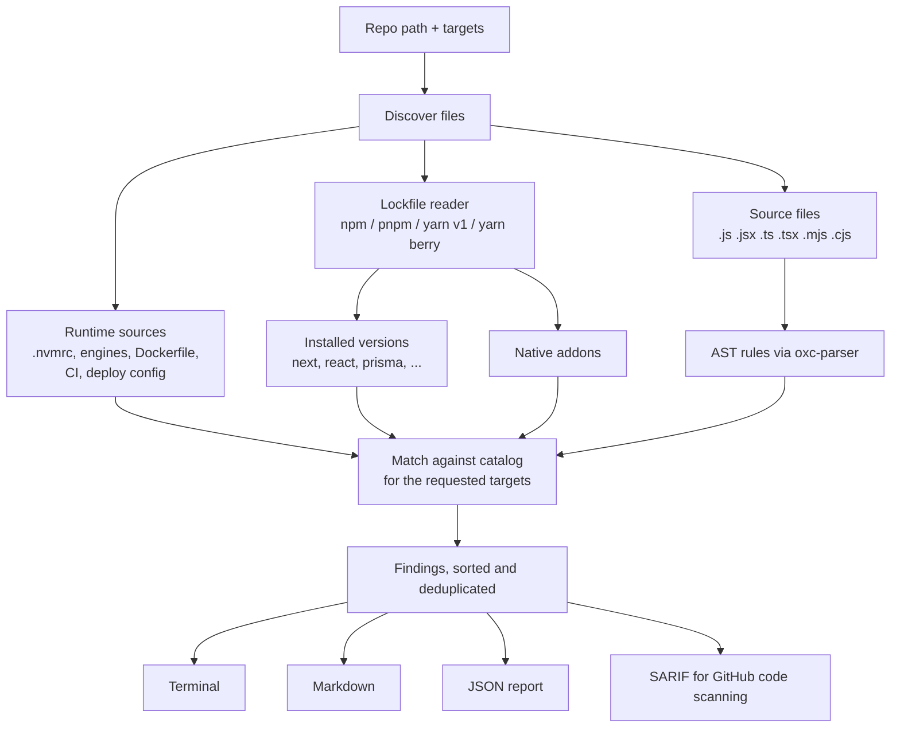
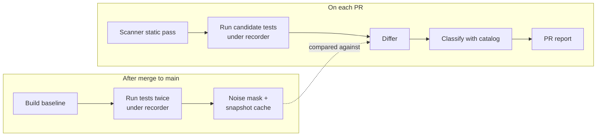

# Architecture

> Name: **Neukee**, a product of GOkit4dev (ADR-008). The trademark search runs in T-053, before the first npm publish.

This document is the source of truth for how the system is built. If code and this document disagree, the code is wrong or this document must be updated in the same change, with an entry in `docs/DECISIONS.md`.

## 1. What the system is

A verification tool for dependency, runtime and framework upgrades in Node.js and Next.js applications. It is delivered in two products that share one core:

| Product     | Release                          | What it does                                                                                                                                         | Runs where                                                       |
| ----------- | -------------------------------- | ---------------------------------------------------------------------------------------------------------------------------------------------------- | ---------------------------------------------------------------- |
| **Scanner** | v0a (launch target: Dec 6, 2026) | Static analysis: reads lockfiles, runtime config, deployment config and source code; reports what blocks a target upgrade (e.g. Node 24, Next.js 16) | A developer's machine (CLI) or the customer's CI (GitHub Action) |
| **Engine**  | v0b (after the scanner launch)   | Runs the old and new versions side by side on the customer's tests and reports behavioral differences                                                | The customer's CI only                                           |

Both are **local-first**: no server, no database, no account, no network calls. This is a deliberate product decision (privacy, security review, EU buyers) and an engineering one (nothing to host, nothing to break at 3am).

## 2. Stack

| Concern       | Choice                                                                          | Why                                                                                                         |
| ------------- | ------------------------------------------------------------------------------- | ----------------------------------------------------------------------------------------------------------- |
| Language      | TypeScript, `strict` on, ESM only                                               | Same ecosystem as the users; types are the contract between packages                                        |
| Runtime       | Node.js ≥ 22 for users; Node 24 LTS for development                             | Node 20 is end-of-life; 22 and 24 are supported LTS lines                                                   |
| Packages      | pnpm workspaces (monorepo)                                                      | One repo, several publishable packages, strict dependency isolation                                         |
| Build         | `tsc` for libraries; `esbuild` to bundle the GitHub Action                      | Fewest moving parts; Actions need a single bundled file                                                     |
| Tests         | Vitest                                                                          | Fast, ESM-native, snapshot support                                                                          |
| Lint + format | Biome                                                                           | One fast tool instead of ESLint + Prettier                                                                  |
| JS/TS parsing | `oxc-parser`                                                                    | Fast, error-tolerant, does not depend on the TypeScript compiler API (which TypeScript 7 does not ship yet) |
| YAML          | `yaml`                                                                          | pnpm lockfiles, Yarn Berry lockfiles, GitHub workflow files, catalog entries                                |
| Versions      | `semver`                                                                        | Range and version comparison                                                                                |
| CLI arguments | `node:util` `parseArgs`                                                         | Built in; one fewer dependency to trust                                                                     |
| Release       | Changesets + npm trusted publishing (OIDC) from GitHub Actions, with provenance | Signed, traceable releases with no stored npm token; buyers' security teams check this                      |
| CI            | GitHub Actions (pinned to commit SHAs)                                          | Where the users are                                                                                         |

**Dependency rule:** every new runtime dependency needs an entry in `docs/DECISIONS.md` (why it is needed, its maintenance status, its install scripts). A security tool with 300 transitive dependencies will not pass a buyer's review.

**Not in this stack (on purpose):** Vercel, a database, a backend, user accounts, telemetry. The marketing site and docs live in a separate repository and may use Vercel; the product never calls home.

## 3. Repository layout

```
neukee/
├── CLAUDE.md                 # Project memory for Claude Code (read every session)
├── docs/                     # Architecture, specs, tasks, progress, decisions
├── catalog/                  # Versioned knowledge: what breaks in each release
│   ├── node/                 #   one YAML file per entry
│   ├── next/
│   └── native-addons.yaml    #   known native packages and their first compatible versions
├── packages/
│   ├── core/                 # Types, report schema, catalog loader. Depends on nothing internal.
│   ├── scanner/              # Detectors and the scan pipeline. Depends on core.
│   ├── cli/                  # `neukee` command. Depends on scanner + core.
│   └── action/               # GitHub Action wrapper (task T-040). Depends on cli.
├── fixtures/                 # Small sample repos used by tests (never real customer code)
└── .claude/                  # Claude Code skills, reviewer agent, settings, hooks
```

### Dependency direction (enforced by review, then by a test in T-004)



A package may only import from packages to its right. `core` imports nothing internal. Nothing imports from `cli` or `action`.

## 4. The scanner pipeline



### Stages and their contracts

1. **Discover** — walk the repo from the given path. Respect `.gitignore`, always skip `node_modules`, `.git`, build output (`.next`, `dist`, `build`, `coverage`). Skip files over 1 MB and record them as skipped. Follow no symlinks out of the repo.
2. **Detect** — each detector is a pure function: `(context) => Finding[]`. A detector never throws; failures become `Diagnostic` entries in the report (e.g. "could not parse pnpm-lock.yaml at line 40"). One broken file never stops a scan.
3. **Match** — detectors produce raw facts; catalog entries turn facts into findings for the requested targets. Detection logic lives in code; knowledge (what breaks, severity, fix, source link) lives in the catalog.
4. **Report** — findings are sorted deterministically (severity, then file, then line, then rule id) so that the same input always produces byte-identical output. This is what makes snapshot tests and CI comparisons possible.

## 5. Core types (packages/core)

These are the contract. Changing them is a schema change: bump `schemaVersion`, add a decision record, update snapshots deliberately.

```ts
type Severity = "action-required" | "warning" | "info";

interface Target {
  tool: "node" | "next" | "react" | "prisma";
  version: string;
} // e.g. { tool: "node", version: "24" }

interface Location {
  file: string;
  line?: number;
  column?: number;
} // file is repo-relative, forward slashes

interface Finding {
  ruleId: string; // e.g. "next16/sync-request-apis" — matches a catalog entry id
  severity: Severity;
  title: string; // one line, plain language
  message: string; // what was found, where, why it matters for this target
  fix?: string; // the documented fix
  sourceUrl: string; // the official release note or migration guide
  locations: Location[];
  target: Target;
}

interface Diagnostic {
  level: "error" | "warning";
  message: string;
  file?: string;
}

interface ScanReport {
  schemaVersion: 1;
  tool: { name: string; version: string };
  scannedAt: string; // ISO timestamp — the ONLY non-deterministic field; excluded from snapshots
  root: string; // "." — never an absolute path (no leaking machine paths)
  targets: Target[];
  detected: { node: string[]; packageManager?: string; frameworks: Record<string, string> };
  findings: Finding[];
  diagnostics: Diagnostic[];
  stats: { filesScanned: number; filesSkipped: number; durationMs: number };
}
```

## 6. The catalog

The catalog is the product's knowledge and its long-term moat. Each entry is one YAML file:

```yaml
id: next16/sync-request-apis
title: Synchronous request APIs are removed
applies:
  tool: next
  introducedIn: "16.0.0" # the version where this starts to apply
severity: action-required
detector: ast/sync-request-api # which code-level detector produces the facts
message: >
  `cookies()`, `headers()`, `draftMode()`, `params` and `searchParams` must be awaited.
  Next.js 15 allowed synchronous access with a warning; Next.js 16 removes it.
fix: Run `npx @next/codemod@canary upgrade latest`, then fix the call sites it reports.
sourceUrl: https://nextjs.org/docs/app/guides/upgrading/version-16
fixtures:
  positive: fixtures/rules/next16-sync-request-apis/positive
  negative: fixtures/rules/next16-sync-request-apis/negative
```

**Catalog rules (enforced by tests):**

- Every entry has a `sourceUrl` pointing to an official source. No entry is written from memory.
- Every entry has a positive fixture (must produce the finding) and a negative fixture (must not).
- Severity is `action-required` only when the change breaks the build or the running app; `warning` for deprecations; `info` for behavior changes worth knowing.

## 7. Security model

The scanner reads code that belongs to someone else. Its guarantees:

1. **No network.** No `fetch`, no sockets, no DNS. Enforced by a test setup that makes any network call fail (`vitest.setup.ts`).
2. **Read-only.** It writes only the output file the user names. It never runs the scanned project's code, scripts or package manager.
3. **No absolute paths or secrets in output.** Paths are repo-relative. File contents are never copied into reports beyond the single line needed to locate a finding.
4. **Minimal Action permissions.** `contents: read`; `security-events: write` only when the user enables SARIF upload.
5. **Supply chain.** Few dependencies, pinned Actions, npm provenance, a lockfile committed, Renovate/Dependabot on our own repo.

## 8. Quality gate (every change, no exceptions)

`pnpm verify` runs, in order: typecheck → lint → tests (unit, rule fixtures, snapshot tests on fixture repos). CI runs the same command on Node 22 and 24, on Linux and Windows.

Around it (ADR-007), because AI writes both the code and the tests:

- `pnpm check:all` adds **Knip** (unused files, exports, dependencies) and `pack:check` (**publint** and **Are the Types Wrong**). CI runs both in the `quality` job.
- **Stryker** mutation testing runs nightly; the score must reach 80% on core and scanner (T-038).
- **CodeRabbit** reviews every PR with the rules in `.coderabbit.yaml`; **CodeQL** and **OpenSSF Scorecard** run on GitHub; **Dependabot** keeps SHA-pinned Actions and dev tools current.
- From T-037, a nightly **corpus job** scans 100+ pinned public repos and fails on any crash or unexpected output change.

**How we avoid breaking old work (regression strategy):**

- **Golden snapshots:** each fixture repo has a committed expected report. Any change in output fails the test until a human-readable reason is written in the commit message and the snapshot is deliberately updated.
- **Rule fixtures:** every catalog entry keeps its positive/negative fixtures forever.
- **Contract tests:** core types and the JSON schema are tested; breaking them requires a schema version bump.
- **Small steps:** one task per change; the gate must pass before the next task starts.

## 9. The engine (v0b), at architecture level

Designed now so the scanner does not paint us into a corner; built after the scanner launches. Full outline in `docs/SPEC-ENGINE.md`.



Future packages: `recorder` (Node `diagnostics_channel` subscribers loaded with `--import`), `runner` (baseline/candidate orchestration and caching), `differ` (normalization, noise mask, classification). They depend on `core`; `scanner` stays independent of them.
